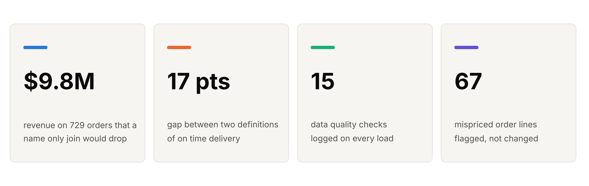
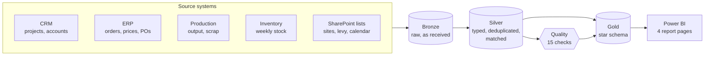
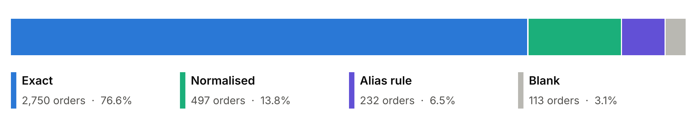
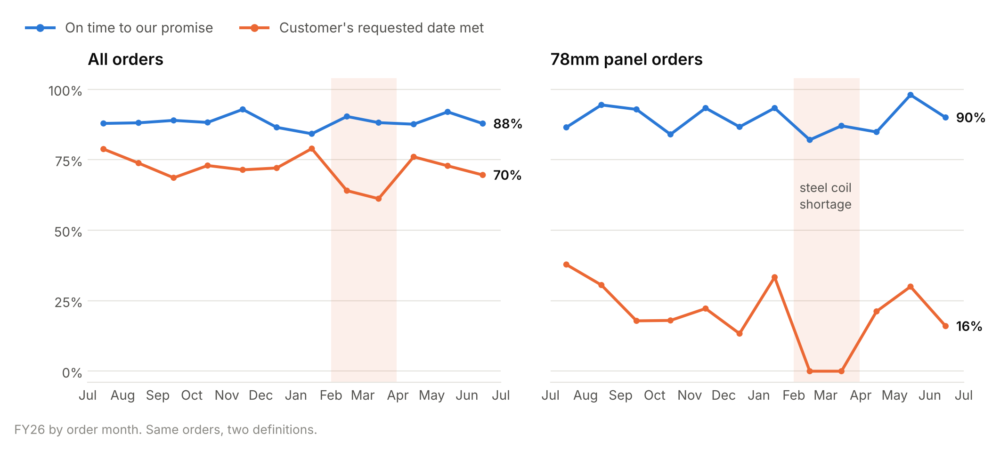
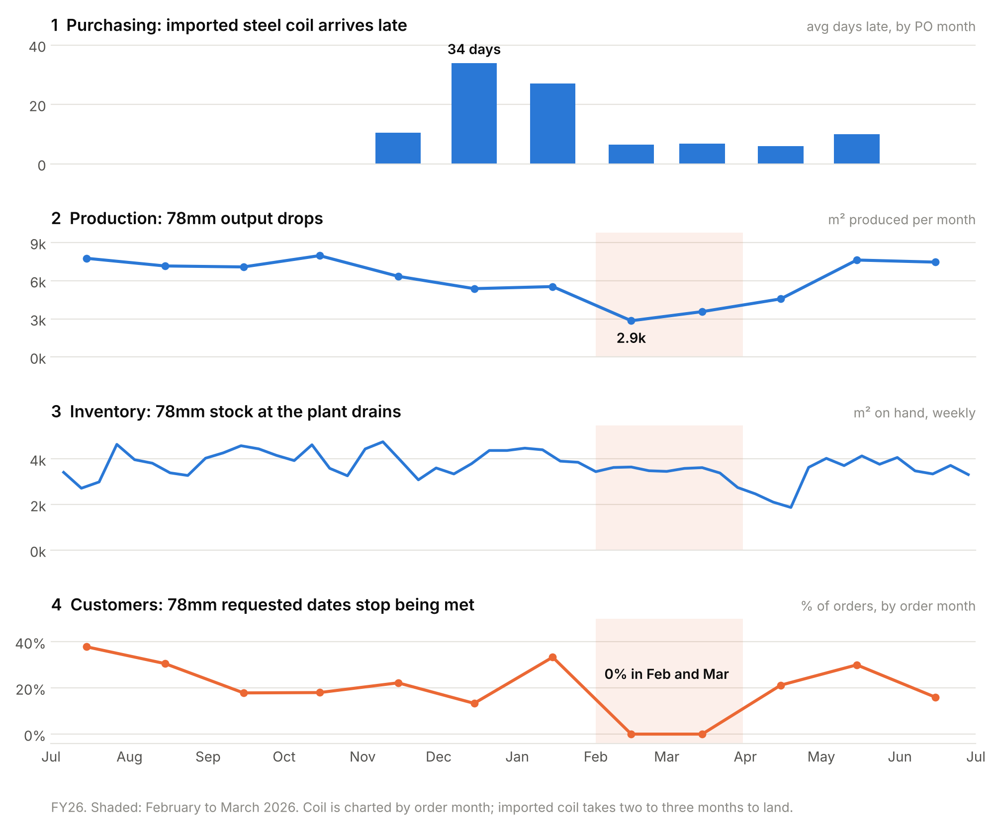
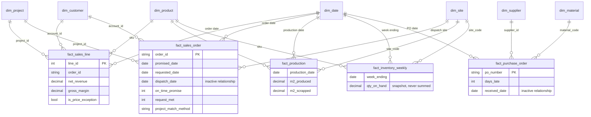

# Manufacturing Operations Data Model

**Five business systems that were never designed to talk to each other, joined into one trusted warehouse and reported in Power BI.**


> [!NOTE]
> All data is synthetic, modelled on a mid sized Australian building products manufacturer. No figure here describes a real company.

<picture>
  <source media="(prefers-color-scheme: dark)" srcset="docs/img/hero-dark.png">
  
</picture>

## The problem

A manufacturer runs a CRM for projects, an ERP for orders and purchasing, a production system, a warehouse system and a pile of SharePoint lists. Each answers its own questions well. None of them can answer *"why did that customer's order arrive late?"* on its own, and when two reports disagree, nobody can say which one is right.

This project builds the layer underneath the reporting: land everything, clean it, match it, check it, and model it so one number means one thing.

## How it works



| Layer | What happens | |
|---|---|---|
| **Bronze** | Every export lands exactly as received, as text, stamped with its source file and load time | [`01_bronze.sql`](sql/01_bronze.sql) |
| **Silver** | Typed and deduplicated; state names conformed; ERP orders matched to CRM projects in three passes | [`02_silver.sql`](sql/02_silver.sql) |
| **Quality** | Fifteen checks logged as Pass, Warn or Fail, with row counts, dollar value at risk and the action taken | [`03_quality.sql`](sql/03_quality.sql) |
| **Gold** | Star schema of 5 facts and 7 dimensions, plus quality results and locked metric definitions | [`04_gold.sql`](sql/04_gold.sql) |

## What the model found

### 1. One in five orders could not be linked to its project

The ERP stores the project as free text, so a plain join on the name only links 77% of orders. Normalising case and spacing, then seven alias rules for abbreviations like `Twr` for Tower, recovers **729 orders and $9.8M of revenue** that would otherwise vanish from project reporting.

<picture>
  <source media="(prefers-color-scheme: dark)" srcset="docs/img/matching-dark.png">
  
</picture>

The alias rules live in [`ref/project_alias_rules.csv`](ref/project_alias_rules.csv), not in code, so a new abbreviation is a one line change. The 113 orders with no project at all are reported under an explicit *Unassigned* project instead of being dropped.

### 2. "On time" meant two different things

Against the date we promised, delivery is **88.8% on time**. Against the date the customer asked for, it is **71.3%**. Same orders, a 17 point gap. The gap is almost entirely one product: 51mm and 64mm panels meet the requested date about 94% of the time, the made to order 78mm panel about 19%.

<picture>
  <source media="(prefers-color-scheme: dark)" srcset="docs/img/on-time-dark.png">
  
</picture>

Both are kept, with locked definitions and new names: **On Time Delivery (Promise)** for operations, **Request Met Rate** for the customer view. Reporting only the first would have hidden the shortage below completely.

### 3. One supply problem, visible only when four systems share a model

Imported steel coil ordered between November and January arrives up to 34 days late. Two to three months later, 78mm production halves, plant stock drains to its low point in April, and for orders placed in February and March, not one 78mm customer gets their requested date. Each system shows one piece. Only the shared date and product dimensions connect them.

<picture>
  <source media="(prefers-color-scheme: dark)" srcset="docs/img/disruption-dark.png">
  
</picture>

### 4. The best performing project was a data error

The top project by revenue showed a 50% gross margin. One order line was keyed at ten times its list price, **$599.90 per m² against $67.65**. Without it, margin is 34.5% and the project is no longer top. The quality layer flags that exact line, along with 66 others, 39 of which were *under*charged.

## Data model



Modelling decisions worth noting:

- **Two facts at two grains.** Order lines carry revenue; order headers carry delivery dates. They are deliberately not joined, and meet through shared dimensions.
- **One active date relationship per fact.** Dispatch date and PO received date are inactive and switched on with `USERELATIONSHIP` only where a measure needs them.
- **Stock is a snapshot.** It is never summed over time; the measure reads the latest week inside the current filter.
- **Australian financial year.** July to June throughout, with year to date filtered on financial year number rather than `TOTALYTD`, so it does not depend on locale year end strings.

## Data quality

Every check runs on every load and is logged, including the ones that pass, so the report proves what was tested rather than only what broke.

| | Check | Result | What happens |
|---|---|---|---|
| ✅ | Order lines with no header, unknown SKUs, unknown customers, negative quantities, impossible dates, stale sources | 0 issues across 8 checks | Would quarantine or flag |
| ⚠️ | Duplicate rows in the ERP export | 43 orders, 192 lines | Removed in silver |
| ⚠️ | State written 16 different ways | 71 projects | Conformed through a mapping table |
| ⚠️ | Orders not linked to a project | 113 orders, $1.46M | Reported as Unassigned |
| ⚠️ | On time measured two ways | 777 orders disagree | Split into two locked metrics |
| ❌ | Line price outside 50% to 200% of the price list | 67 lines, ~$960K at risk | **Flagged, not changed.** Finance corrects at source |
| ❌ | Dispatched with no dispatch date | 17 orders | Excluded from delivery metrics, flagged to operations |

Why flag prices instead of fixing them: if the warehouse quietly corrects a financial figure, it disagrees with the ERP and the invoices forever. The fix belongs at source; the warehouse's job is to make the problem impossible to miss.

## Power BI report

Four pages built on the gold layer: **Overview** (revenue, margin, segment and project mix), **Delivery** (both on time definitions, by product and site), **Supply and Stock** (supplier lateness, production, stock cover by site) and **Data Quality** (the fifteen checks, row level exceptions, locked definitions).

<details>
<summary><b>DAX patterns used</b> (48 measures in <a href="powerbi/"><code>powerbi/</code></a>)</summary>

<br/>

**Switching to an inactive relationship**, so orders can be sliced by the month they were dispatched rather than placed:

```dax
OTD (Promise) % by Dispatch Date =
CALCULATE ( [OTD (Promise) %], USERELATIONSHIP ( fact_sales_order[dispatch_date], dim_date[date] ) )
```

**A semi additive snapshot**, reading only the latest week in the current filter:

```dax
Stock on Hand =
VAR _lastWeek = CALCULATE ( MAX ( fact_inventory_weekly[week_ending] ) )
RETURN CALCULATE ( SUM ( fact_inventory_weekly[qty_on_hand] ), dim_date[date] = _lastWeek )
```

**A virtual relationship** between two facts that are deliberately not joined:

```dax
Revenue Recovered by Matching =
VAR _orders =
    CALCULATETABLE ( VALUES ( fact_sales_order[order_id] ),
        fact_sales_order[project_match_method] IN { "Normalised", "Alias rule" } )
RETURN CALCULATE ( [Net Revenue], TREATAS ( _orders, fact_sales_line[order_id] ) )
```

</details>

## What I would change in production

- **Stop the matching problem at source.** If order entry picked the project from a list fed by the CRM, there would be nothing to match.
- Surrogate keys and Type 2 history on dimensions, instead of natural business keys.
- Incremental loads with a watermark rather than full reloads.
- Move the one calculated column in the report into the gold layer.
- Add an upper band to stock cover, so overstocking shows up as clearly as shortages.

<details>
<summary><b>Repository layout and running it</b></summary>

<br/>

```
sql/                  the four warehouse layers
ref/                  reference data the data team maintains (state mapping, alias rules, metric definitions)
raw/                  simulated source exports
gold/                 star schema as CSV, ready for Power BI
powerbi/              DAX measures, calculated column, report theme
docs/                 README figures and the script that draws them
generate_sources.py   seeded synthetic data generator
run_pipeline.py       runs bronze, silver, quality and gold
```

```bash
pip install duckdb pandas numpy matplotlib
python generate_sources.py
python run_pipeline.py
python docs/make_figures.py
```

</details>

---

Built by **Anson Sebastian** with Claude as an AI pair. The design, definitions and matching rules are mine, and every figure was checked against the data. Licensed under [MIT](LICENSE).
